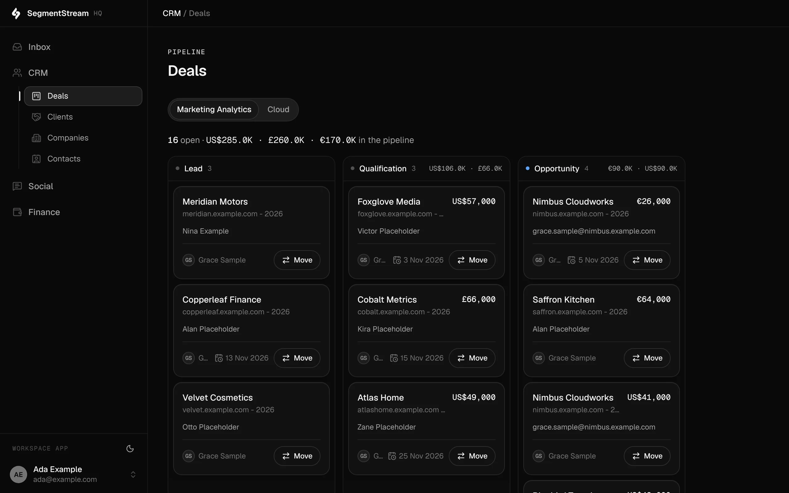
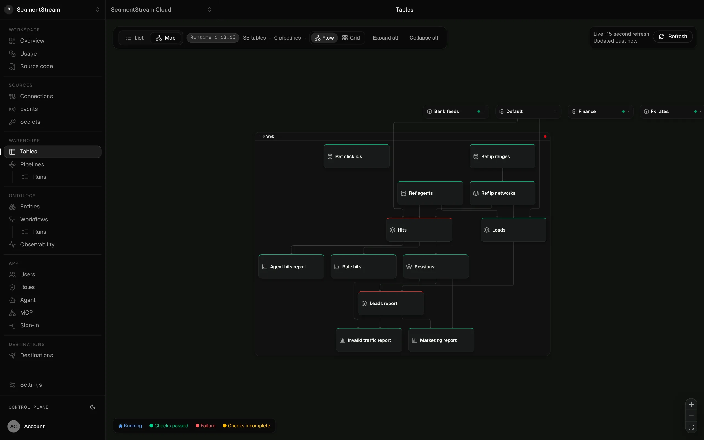
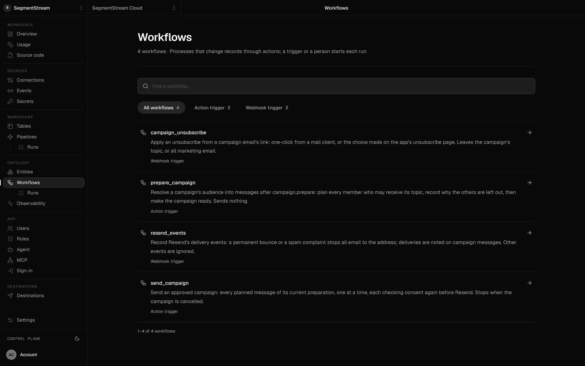
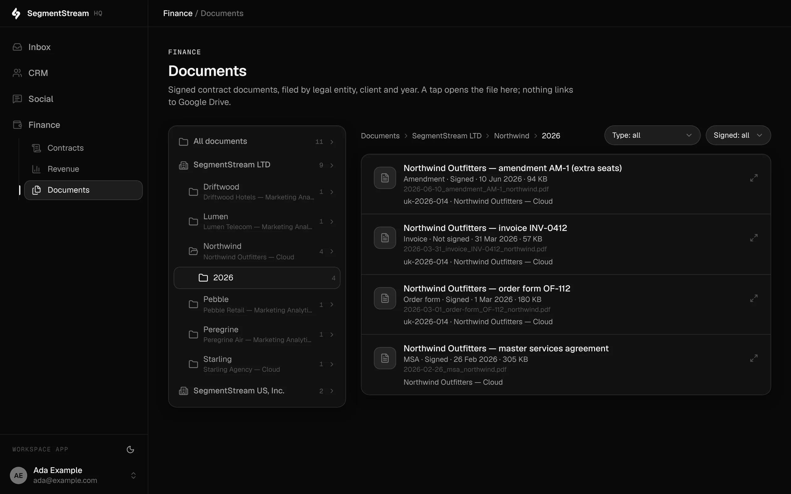
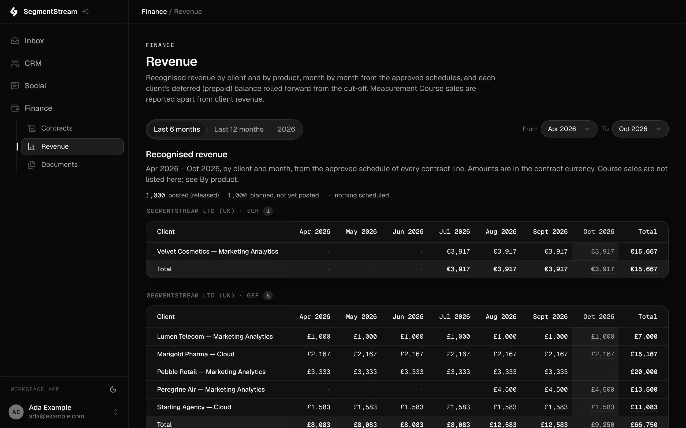
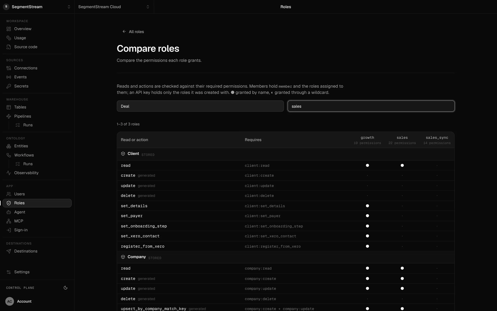
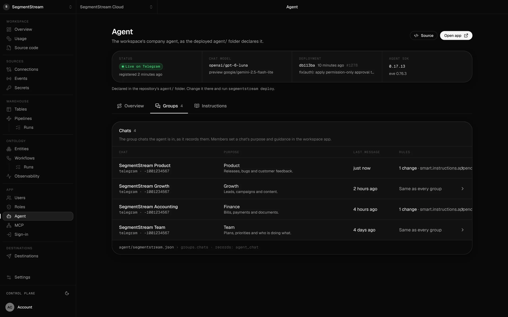
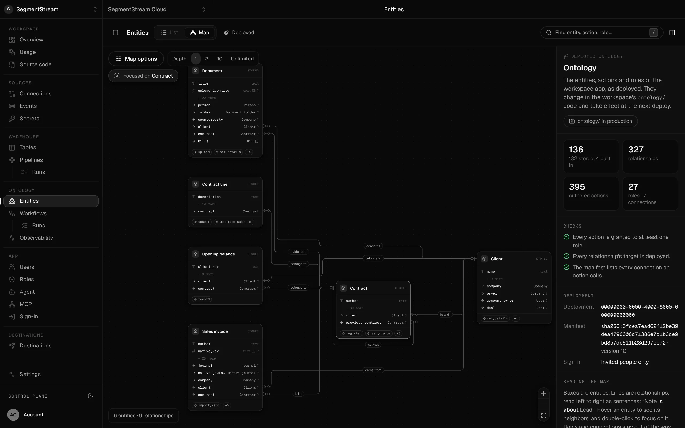

# Build your own CRM, analytics, books and e-signature with your AI agent

**Blueprints for the era of custom software. Give one to your coding agent and it builds software shaped to your company: marketing analytics, CRM, email marketing, bookkeeping, ad fraud detection, a company agent, a document drive and e-signature. The [SegmentStream platform](https://segmentstream.com) runs it and does the heavy lifting: the company database, permissions, warehouse, real-time event collection, pipelines and secure connections.**

[](LICENSE)


Companies no longer have to rent software built for someone else's process, or
install someone else's code and bend it to fit. With a good example, a coding
agent can build software that fits your company exactly. These blueprints are
those examples: each one is the design, the questions to ask, the rules that
must always hold and the mistakes to avoid, taken from software already running
in production.

Nothing here is installed. Give your coding agent this repository and say what
you want. It asks about your company, shows you a plan, and builds your own
version on [SegmentStream](https://segmentstream.com), the platform for a
company's custom software and AI agents. Your agent writes the business logic;
the platform runs everything underneath it, from the database and permissions
to the warehouse, event collection and pipelines.

```text
Read https://github.com/segmentstream/build-your-own/blob/main/AGENTS.md and follow it.
I want our own CRM, shaped to how we sell.
```

Paste that into Claude Code, Codex or Cursor. Other things to ask for:

- *Build our own marketing analytics on our own tracker, instead of Google Analytics.*
- *Replace Mailchimp with email marketing on our own customer data.*
- *Set up our bookkeeping: ledger, invoices, P&L and balance sheet.*
- *Give us a DocuSign alternative and send contracts from deals.*



<sub>A deals pipeline built from these designs on the SegmentStream platform. Demo data.</sub>

## Blueprints

| Blueprint | Build your own… | Instead of | Status |
| --- | --- | --- | --- |
| [Marketing analytics](blueprints/marketing-analytics/) | Web, product and marketing analytics on your own tracker: sessions, an identity graph, ad spend stitched to visits, conversions, attribution, and which AI agents read your site | Google Analytics, ad-platform reports | stable |
| [CRM](blueprints/crm/) | Companies, contacts, leads and a deal pipeline shaped to how you sell | HubSpot, Salesforce | preview |
| [Email marketing](blueprints/email-marketing/) | Consent, audiences on your own CRM data, campaigns with approval, delivery events | Mailchimp, Klaviyo | stable |
| [Bookkeeping](blueprints/bookkeeping/) | One journal, invoices, bills, fixed assets, multi-currency, P&L and balance sheet | Xero, QuickBooks | stable |
| [Ad fraud detection](blueprints/ad-fraud-detection/) | A verdict with evidence for every website session: bots, automation, data-centre and proxy traffic, AI agents; the complete production rule set | ClickCease, traffic verification vendors | stable |
| [Company agent](blueprints/company-agent/) | An AI agent in Slack, Telegram or WhatsApp that works on your records with each person's permissions | Microsoft 365 Copilot, Slack AI | preview |
| [Drive](blueprints/drive/) | Folders, online documents, versions, sharing and comments, linked to your records | Google Drive, Google Docs | stable |
| [E-signature](blueprints/e-signature/) | Envelopes, signers, a signing page and sealed, timestamped PDFs | DocuSign | stable |

Replacing a specific tool? The [alternatives list](docs/alternatives.md) maps
more than 70 products, from DocuSign and HubSpot to QuickBooks and Google
Analytics, to the blueprint that replaces them.

Most blueprints build on the shared [foundation](foundation/FOUNDATION.md):
companies, contacts, members and the conventions they all follow.

## The platform does the heavy lifting

A blueprint tells your agent what to build. The
[SegmentStream platform](https://segmentstream.com) is where it runs, and it
takes on the parts of company software that are hardest to build and to keep
running. Your agent writes only your business logic: the records, rules,
screens and reports that make the software yours.

| SegmentStream runs | So your agent never builds or operates |
| --- | --- |
| **A company database.** Every write is an action with a permission check on the server, for people, apps and agents alike. Every change is kept in history. Schema changes are planned, tried on a copy first, and refused when unsafe. | A database, migrations, an API, an authorization layer and an audit log |
| **Sign-in and roles.** Members sign in; roles are written in code and enforced on every record. | An identity provider and an access model |
| **An API and MCP server for every record.** Claude, ChatGPT and your own agents work with your software through the same permission checks as people. | An integration layer for agents |
| **Real-time event collection.** One endpoint, served by the nearest healthy collector in the US or EU, streams events into warehouse tables in your region with no ingestion job. A first-party tracker covers the browser and the server. | A tag pipeline, collectors and queues |
| **A warehouse with a metrics layer.** Your records replicate into it automatically, next to event and provider data. The same metrics answer screens, the API and agents. | A data warehouse, replication from your database and a semantic layer |
| **Pipelines.** Managed orchestration of ingestions and models: schedules, daily partitions, backfills, retries, checks and lineage, each step in its own isolated worker. | An orchestrator, its workers and a transformation tool |
| **Secure connections.** OAuth and API-key connections to the tools you use, in and out. Credentials stay in SegmentStream and reach the provider through a proxy; your code never sees them. | A secrets store, token refresh and connectors |
| **Workflows and webhooks.** Durable processes started by an action, a schedule or a webhook, with retries and a record of every run. | A job queue, its workers and webhook endpoints |
| **A company agent.** Your team's agent in Telegram, Slack or WhatsApp, acting with each member's own permissions. | An agent runtime and chat integrations |
| **Hosting and safe change.** Deploys from your Git repository, previews, and development sessions on a private copy of production data, in the region you choose (EU or US). | Servers, CI and staging environments |

As with any cloud platform, SegmentStream runs the infrastructure, and what you
build on it is your company's own software, in your company's own Git
repository.

<table>
  <tr>
    <td><br><sub>Marketing analytics: from raw hits to reports, every table checked</sub></td>
    <td><br><sub>Email marketing: prepare, send, unsubscribe and delivery workflows</sub></td>
  </tr>
  <tr>
    <td><br><sub>Drive: documents filed by company and year</sub></td>
    <td><br><sub>Bookkeeping: revenue by client and month</sub></td>
  </tr>
  <tr>
    <td><br><sub>Roles written in code and checked on the server</sub></td>
    <td><br><sub>The company agent in the team's chats</sub></td>
  </tr>
</table>

## How it works

1. **Pick.** Your agent reads [`registry.json`](registry.json) and chooses the
   blueprints that match what you asked for.
2. **Interview.** It asks the questions in the blueprint's interview: how you
   sell, who approves what, which tools you keep. About ten questions, once.
3. **Plan.** It shows you one page: the records, actions, roles, screens and
   data sources it will build, and what it leaves out. You approve or change it.
4. **Build and test.** It writes your version and turns every invariant into a
   test that runs on your laptop, with no account and no real data.
5. **Deploy.** When you say so, it deploys to your SegmentStream workspace. You
   authorize your own connections; your data never touches this repository.

The full procedure your agent follows is in [AGENTS.md](AGENTS.md).

## Why blueprints, not open source

In April 2026 Andrej Karpathy suggested that, with coding agents, there is less
point in sharing code: share the idea, and the other person's agent builds a
version for their needs. We agree, with one change. For a ledger, an
e-signature or an identity graph, an idea is not enough: some rules must never
break, and agents keep making the same mistakes. So each blueprint carries the
idea, the questions to ask, the invariants with their tests, and the pitfalls
we hit in production. [How it works](docs/how-it-works.md) explains the format.

## Proven in production

Every `stable` blueprint is taken from custom software running in production
on the SegmentStream platform. Our own team runs the company on it, from the CRM
and campaigns to the books, documents and signatures: one workspace with 136
entities, 395 actions and 27 roles, built and maintained by coding agents, where
every change goes through the same rules your version will.



## Questions

**Is this open source?** The blueprints are Apache-2.0: read, adapt and reuse
them freely. They are written for the SegmentStream platform, which runs the
software your agent builds. The designs, invariants and interviews are useful
on any stack.

**Do I need to be a developer?** No. You need a coding agent and the ability to
answer questions about how your company works. The agent writes, tests and
deploys the code.

**Can I try it before I have access?** Yes, up to deployment. Your agent builds
the project and runs every invariant test locally, on invented data; deploying
it and opening the screens needs a SegmentStream workspace.

**What does it cost?** The blueprints are free. Running your software on
SegmentStream is billed by usage: see [pricing](https://segmentstream.com/pricing).

**Does anything here touch my data?** No. Blueprints contain designs and
invented demo data. Your data reaches only your own workspace, through
connections you authorize.

**Can someone build it for us?** Yes. SegmentStream's engineers build the first
version on your data in a fixed-price pilot: [start a pilot](https://segmentstream.com/enterprise).

## Request a blueprint

Missing something your company needs? [Request a blueprint](https://github.com/segmentstream/build-your-own/issues/new?template=blueprint-request.yml),
or add a thumbs-up to an [open request](https://github.com/segmentstream/build-your-own/issues?q=is%3Aissue+is%3Aopen+%22Blueprint%3A%22+in%3Atitle).
We build the most-wanted ones first. To improve an existing blueprint, see
[CONTRIBUTING.md](CONTRIBUTING.md).

## Contribute a blueprint

Know a business from the inside? If you have built or implemented the software
an industry runs on (an ERP, a booking or practice management system, a field
service tool, the books of a particular kind of company), you know what generic
SaaS gets wrong about it. Write it down as a blueprint and every company's
coding agent can build it right. Your agent does the formatting: it interviews
you and writes the files. See [CONTRIBUTING.md](CONTRIBUTING.md) and the
[wanted blueprints](docs/wanted.md), from booking and hotel operations to
property management, legal practice and ERP-lite.

## Get started

Install the CLI and give your agent this repository:

```sh
curl -fsSL https://segmentstream.com/install.sh | sh
```

New to SegmentStream? [Request access](https://segmentstream.com/#waitlist).

## License

[Apache License 2.0](LICENSE). Screenshots show invented demo data. Product
names are trademarks of their owners, named only to describe what a blueprint
can replace.
