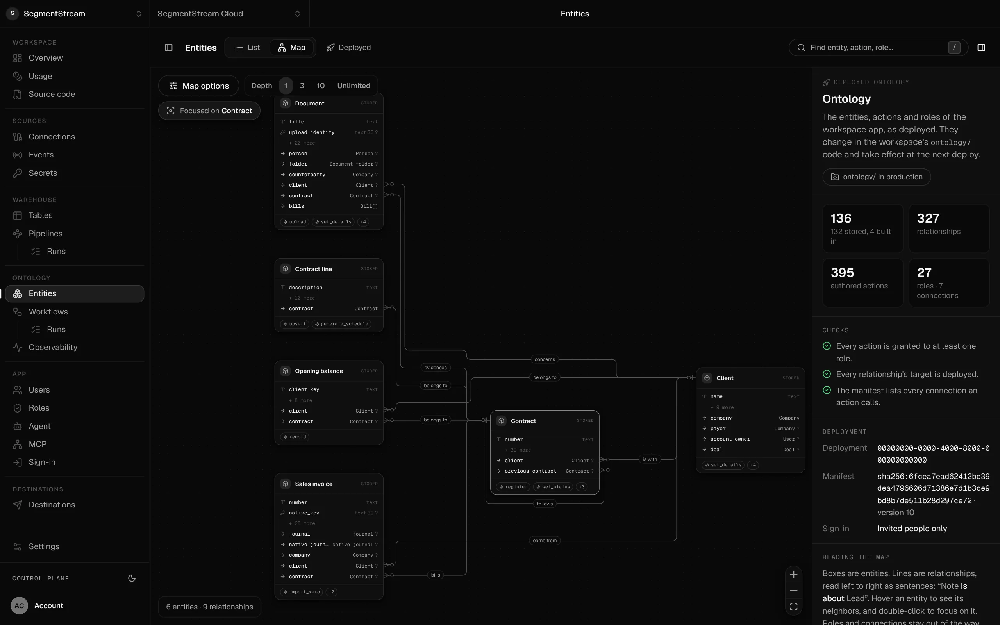

# How it works

## Blueprints, not packages

Open source software is finished code you install and then bend to fit your
company. A template is a copy that starts drifting from its source the day you
fork it. A blueprint is neither. It is what we learned running a piece of
company software in production, written so a coding agent can build your own
version of it:

- **the design**: records, actions, roles, workflows, data flow and screens;
- **the interview**: what to ask you, and what each answer changes;
- **the invariants**: rules that must hold in every version, each with a test;
- **the variations**: where companies legitimately differ, and the default;
- **the pitfalls**: mistakes agents already made, so yours does not.

Your agent reads the blueprint, asks you the questions, shows you a plan, and
writes the software into your own repository. Two companies that build from the
same blueprint end up with different software, because they sell, invoice and
report differently.

## What SegmentStream provides

The code a blueprint produces is only your business logic. Everything every
company app needs runs on the platform:

| You write (with your agent) | SegmentStream runs |
| --- | --- |
| Entities, actions, roles and workflows in `ontology/` | A company database with server-side permission checks on every record, a history of every change, a REST API and MCP tools for any agent |
| Screens in `app/` | Hosting, sign-in, previews, deploys from `main` |
| Ingestions and models in `pipeline/` | A warehouse, orchestration, schedules, checks and lineage |
| Connection declarations in `connections/` | OAuth, credential storage and an authenticated client; credentials never reach your code |
| Event streams in `events/` | Regional collection endpoints and storage |
| The workspace agent's instructions in `agent/` | The agent in Slack, Telegram or WhatsApp, acting with each member's permissions |

Everything lives in one Git repository your company owns. `segmentstream
deploy` publishes it.

*SegmentStream's own workspace: 136 entities, 327 relationships, 395 actions
and 27 roles, built and maintained by coding agents. Demo data shown.*

## Data and connections

A blueprint is never connected to anyone's real account.

- **Connections are declarations.** The code names a provider, a key and the
  permissions it needs. You authorize it after deploying, in the console or with
  `segmentstream connection authorize <key>`. Tokens never enter the repository.
- **Every source has two adapters.** A `sample` adapter generates invented,
  deterministic data in code; a `real` adapter reads through a connection. Both
  write the same contract table, so models, reports and tests do not care which
  one ran. Tests, demos and screenshots use `sample`.
- **Records are created by actions.** Demo records for CRM, bookkeeping or
  documents are created by a script that calls the same actions people and
  agents use.

## Built in production first

Every blueprint marked `stable` describes software SegmentStream runs on its own
company or for its customers. The blueprints are extracted from that code,
generalized, and stripped of anything specific to one company. `preview` means
the design is sound but details are still moving.

## What stays with SegmentStream

Blueprints describe complete, working software. A few things remain products or
services of SegmentStream rather than blueprints: advanced attribution models,
budget optimization and incrementality experiments for marketing analytics, and
engineers who build the first version with you. See https://segmentstream.com.
